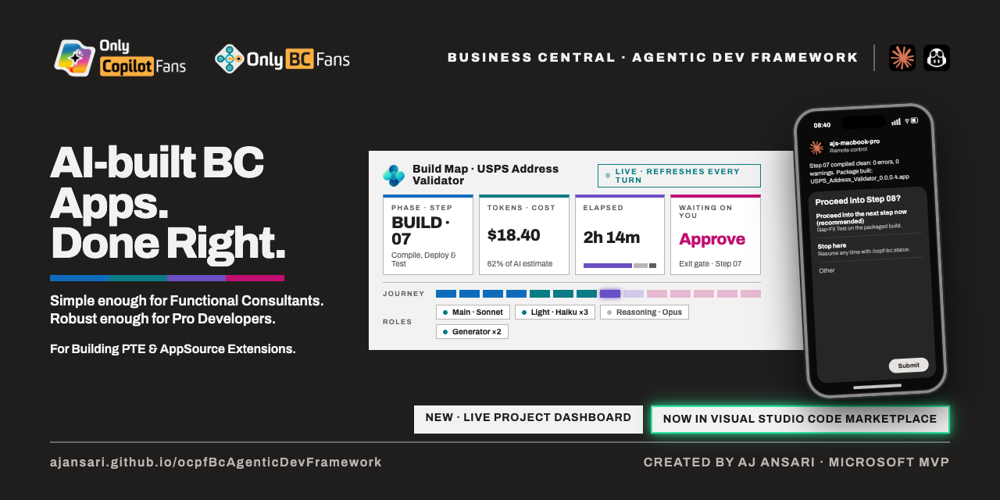
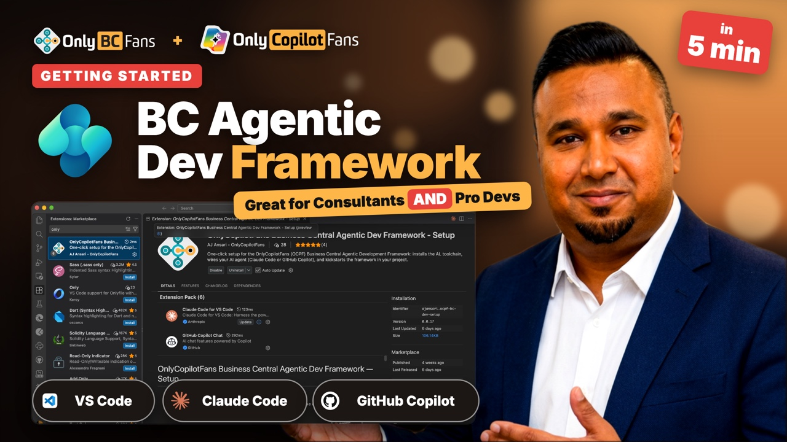
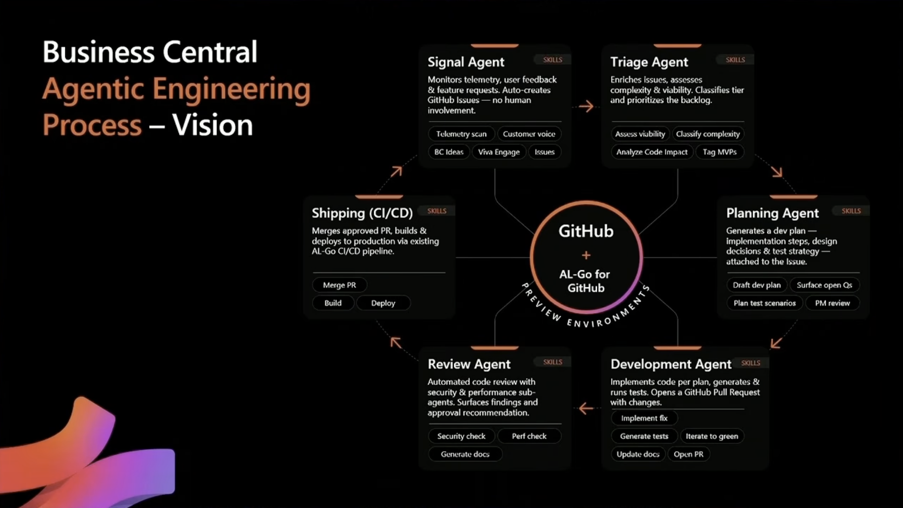
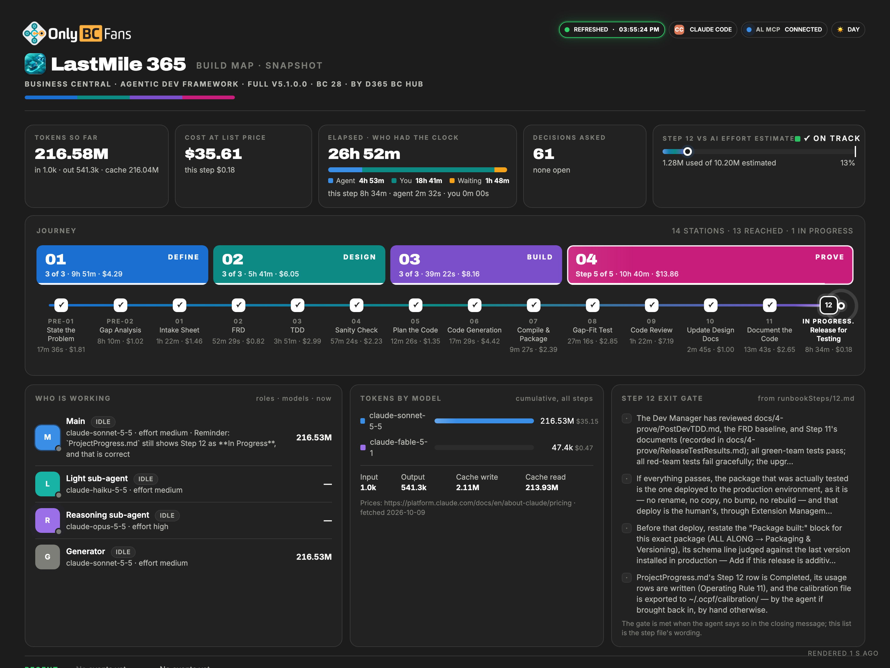

# OCPF BC Agentic Development Framework

**The OnlyCopilotFans Business Central Agentic Development Framework**

Simple Enough for Functional Consultants. Robust Enough for Pro Developers.  

*by AJ Ansari*

*Last Updated: Wednesday, October 21, 2026*

> ## 🌐 [Official Website](https://bcdev.ai)
>
> **<https://bcdev.ai>**
>
> What the framework is, how it works, and what it produces. **Start here if you're new** — then
> come back for setup.

### ▶️ Getting Started in 5 Minutes (video)

[](https://www.youtube.com/watch?v=UvpLaPTld0I)

Install the Visual Studio Code extension, then configure Claude Code and GitHub Copilot — **[watch on YouTube](https://www.youtube.com/watch?v=UvpLaPTld0I)**.

## Table of Contents

- [Background](#background)
- [User Guide](FrameworkUserGuide.md) — the full guide for the person driving a project
- [What to Expect](#expect)
- [GET STARTED: Agent Plugin (Recommended)](#setup-plugin)
- [Staying Up to Date](#staying-up-to-date)
- [Getting Started — Alternative Ways](GettingStartedAlternatives.md) (CLI tools, other hosts, manual setup)
- [Roadmap](#roadmap)
- [Repo Contents](#contents)
- [License](#license)
- [Project Inspiration](#inspiration)
- [What's New?](#whats-new)

<a id="background"></a>
<details open>
<summary><h1>Background</h1></summary>

This Agentic Development Framework was created to help Business Central Functional Consultants use AI to build AL extensions and apps the **right** way — though professional AL developers will find it just as useful.

The framework incorporates the AL MCP Server, BC Base App and System App documentation from Microsoft Learn, Microsoft's AL Guidelines, and BCQuality, grounding the agent's guidance in official references and quality tooling rather than AI guesswork alone. Alongside the runbook sits my **OCPF AL Development Standards Guide** — the detailed AL rules the routine applies at each step — which the agent fetches into your project automatically.

Full and Lite are multilanguage from the ground up. Captions and messages use XLIFF translation files, never `CaptionML`. Regional terminology comes from Microsoft's own Business Central translations. The agent drafts translations, a named human approves them, and UAT runs in every required language. Build-a-Feature writes source labels only and leaves the generated `.g.xlf` for whoever adds languages later. In every journey you can work with the agent in your own language. See [Multilanguage Support](translationAndMultiLanguage/MultilanguageSupportOverview.md).

**Three journeys, one standard.** The choice is about the kind of work, not a file count:

- **Build-a-Feature** — quick, tactical customizations when time is of the essence: extend a table or a page, a processing report, a table and its pages, an API, a role center, an enum, a permission set. **It is not vibe-coding** — the same Standards Guide, patterns library, and analyzers govern every file — but it is lean on documentation: no design documents or test scripts, six short documents in a flat `docs/` folder written as the work happens. It builds what you ask for, not a holistic solution, which makes it ideal for a PoC app for a demo or a prototype; the foundation is sound enough that an agent or a developer can later turn it into a full solution. Minutes — usually 10 to 20 — at very low token consumption: at published API rates most builds cost $1 to $5.
- **Full** (14 steps; the recommended journey) — a complete app or solution built end to end, or a major overhaul of a big existing app. It reviews the requirements in detail and produces an FRD, a TDD and Sanity Check, a build plan, a graded code review, full documentation, a user guide, testing guides, and automated test scripts. It runs on three models — Main, Reasoning, and Light — for the highest-quality outcome, which also makes it the slowest: at least three to four hours end to end, longer for an extensive app, plus your own review time — still far less than a development team needs for an app of the same size.
- **[Lite](GettingStartedAlternatives.md#lite-edition)** (7 steps) — updating an existing app, or a new app without a large footprint. One Main model does everything in fewer steps with leaner documents (a Design Doc, Docs, a Test Script). It still follows a reliable agentic engineering process with quality outcomes — faster, cheaper, and with less detail. One to two hours depending on complexity.

All three apply the same AL standards; `/ocpf-bc:start` offers all three in that order, Full recommended. **The more well-formed and documented your idea, the faster you get past the first stage:** put your requirements in a `requirements/` folder (`.md` files are recommended; Word, PDF, and images work too) and an app icon in `images/`. Starting from an existing app nobody can explain? `/ocpf-bc:analyze` reads it and documents it first — a presumed FRD and TDD, an object register, documentation with the schema and flows — into `requirements/existing/`, for you to review before any journey extends it.

</details>

<a id="expect"></a>
<details open>
<summary><h1>What to Expect</h1></summary>

**Plan on the first hour being interactive, and treat it as the most important hour of the
project.** Think of it as the kickoff meeting you would hold with a human developer you had just
hired to build this extension. In that meeting you would not say "track bootcamp registrations"
and leave the room. You would explain who uses it and why, which countries and languages they work
in, what it must never do, what it connects to, and how you will know it is right — because
anything you left vague, the developer would have to guess at, and you would find out about the
guess weeks later, in the wrong place, at the cost of a rewrite. The framework is that developer.
In its first hour it asks for everything it needs before it designs anything: your working language,
how to be notified, which models do the work, who signs off, the extension's name and publisher, ID
ranges, countries and languages, and the problem itself — what the app is for, who it serves, and
what is out of scope.

Stay at the keyboard for it. Answer the option boxes, correct anything it suggests, and say more
rather than less when it asks about the problem. Nothing reaches the parameter sheet until you pick
it, and nothing reaches the design until the problem statement is signed off — which means this is
the one point in the project where a better answer costs a minute. **Vagueness here does not
disappear; it flows downstream.** An unstated rule becomes a requirement the FRD never captured, an
object the TDD designed wrong, code that compiles cleanly and does the wrong thing, and a rewrite
that costs more time and more tokens than the conversation would have — exactly as it does with a
human developer, and for the same reason.

**Once the DESIGN phase begins — Full Step 02 (the FRD), Lite Step 2 (the Design Doc) — you can step
away.** From there the framework works in longer stretches and comes back to you only to approve a
document, decide between options, or answer a question. Turn on notifications at the first step and
you'll know the moment it's your turn.

### How you get notified

| | Claude Code | GitHub Copilot |
|---|---|---|
| **Sound** on the computer | Yes | Yes |
| **Desktop notification** (operating system) | Yes — Windows, Linux, and supported terminals on macOS (not the VS Code extension on macOS) | Yes — VS Code's own notification when input is needed |
| **Mobile notification** | Yes — through **Remote Control**, with the Claude app installed on your phone and signed in to the same account as Claude Code in VS Code | No |
| **Answer from the phone** | Yes — in the Claude app you can read the question, choose an option, and approve an action | No |

The framework asks which of these you want at its first step (right after the working language),
sets them up itself, and remembers the answer per project. With Claude Code, choosing *Claude app*
turns on Remote Control; the framework explains what that stores before turning it on.

**Using GitHub Copilot?** At the same first step the framework asks two Copilot-specific questions:
how many requests an agent turn may make before Copilot pauses (the default is low enough that a
design step hits *"Copilot has been working on this problem for a while…"* — 150 is recommended), and
how tool approvals should work (ask each time, allow the framework's own commands, or allow
everything, with its warning). The request limit goes to the workspace's `.vscode/settings.json`;
the approvals go to your own user settings unless you explicitly choose to share them with the team.

**What it costs, and what it saves.** Every step is measured: tokens by type per model in
Claude Code, AI credits per step in GitHub Copilot, priced at the publisher's published rates —
which the framework's script fetches itself the first time a model appears — next to an estimate
of the hours an experienced senior AL developer would bill for the same step, and next to the AI
effort estimate made before BUILD began. The table lives in `ProjectProgress.md` in every journey,
with one row per step and model (one row per object on Build-a-Feature), written at every step
boundary, and the live dashboard shows the same figures as they happen.

</details>

<a id="setup-plugin"></a>
<details open>
<summary><h1>GET STARTED: Agent Plugin (Recommended)</h1></summary>

> ### Two steps. Install once, then one command per project.
>
> | | |
> |---|---|
> | **1. Install the Visual Studio Code extension** | Once per machine. One install brings everything. |
> | **2. Start your project** | Open your AL folder and run `/ocpf-bc:start`. |

That's it. From there the plugin **helps you choose Build-a-Feature, Full (recommended), or Lite** (or offers to
**analyze and document an existing app first**), **installs the latest runbook** (Full and Lite),
**connects Microsoft's AL tools** with nothing to install, **adds sub-agents** for the Reasoning,
Light, Generator, and Reviewer roles, and **checks for updates** each session before changing
anything.

## Step 1 — Install the Visual Studio Code extension

You build Business Central extensions in **Visual Studio Code** with the **AL Language** extension,
so the framework's front door is a Visual Studio Code extension:

> ### [OnlyCopilotFans Business Central Agentic Dev Framework - Setup](https://marketplace.visualstudio.com/items?itemName=ajansari.ocpf-bc-dev-setup)
> on the **Visual Studio Marketplace** — `ajansari.ocpf-bc-dev-setup`

Install it from the Marketplace page, or paste this into Quick Open (**Ctrl+P**, **Cmd+P** on Mac):

```text
ext install ajansari.ocpf-bc-dev-setup
```

**One install brings:** the AL toolchain (the AL Language extension and its companions), the agent
extension you choose (Claude Code or GitHub Copilot Chat), the framework's plugin marketplace wired
into that agent, the `ocpf-bc` plugin itself, a Git check, six **OCPF BC** Command Palette commands
(*New AL Project + Framework*, *Kickstart Framework Here*, *Set Up Claude Code*, *Set Up GitHub
Copilot*, *Update the ocpf-bc Plugin*, *Check Git Installation*), and a first-run walkthrough that
ends at `/ocpf-bc:start`. The extension also keeps the plugin current: it turns on Claude Code's
auto-update for the framework's marketplace and offers *Update now* when a newer plugin exists.
The extension's own documentation is on its Marketplace page. Requirements: Visual Studio Code
1.96 or later, Git, and a Claude or GitHub Copilot subscription.

**Using VSCodium or another Open VSX client?** The same extension is on the
[Open VSX Registry](https://open-vsx.org/extension/ajansari/ocpf-bc-dev-setup).

**Extension not an option?** Working in the **Claude Code CLI** or the **GitHub Copilot CLI**,
running the agent on github.com or in the Claude apps, or setting the framework
up by hand without the plugin — every one of those is in
**[Getting Started — Alternative Ways](GettingStartedAlternatives.md)**.

## Step 2 — Start a project

Open your AL project folder — or an empty one — and run:

> # `/ocpf-bc:start`

Or just ask:

> # *"Start a Business Central project with the OCPF framework."*

In GitHub Copilot, the commands are identical.

**The plugin then walks you through four things:**

| | What happens | What you do |
|---|---|---|
| **1** | **Build-a-Feature, Full, or Lite.** It asks about the work — a complete solution, an update or a modest new app, or a quick customization — and recommends Full unless you say the work is smaller, with its reasoning, in the terms of the *Background* section above. **Build-a-Feature** asks what you want to build, writes the proposed design to `docs/` before confirming the fields in one box, writes and compiles, documents each object as it compiles, offers the next object, then a review and a `.app` — and skips rows 2 and 4 below. On an existing extension nobody can explain, `/ocpf-bc:analyze` is offered before the choice. | Confirm or override. You can switch later without losing work. |
| **2** | **Where the runbook goes.** It places the latest runbook as `CLAUDE.md`, `.github/copilot-instructions.md`, or both for mixed teams. | Nothing, unless a file already exists — then it asks. **It never overwrites.** |
| **3** | **AL tools, nothing to install.** It connects Microsoft's AL tools using the AL Language extension you already have. | In Copilot Chat, nothing — they're built in. In Claude Code, approve the connection once. |
| **4** | **The routine begins.** | Tell it your working language, how you want to be notified, which models do the work, and — with Copilot — the request limit and approval mode — Full asks for a Main, Light, and Reasoning model with a thinking effort each (recommended **Sonnet Medium / Haiku Medium / Opus High** in Claude Code, **Claude Sonnet 5.5 or GPT-6.1 Sol Medium / Claude Haiku 5.5 or GPT-6 Luna Medium / Claude Opus 5.5 or GPT-6.1 Sol High** in Copilot, two options per role at the same price); Lite asks for one (Sonnet Medium; in Copilot Claude Sonnet 5.5 or GPT-6.1 Sol Medium). It warns first that a High thinking effort makes every task slower, and recommends High only where judgment matters most. The Full framework then runs its Reasoning, Light, Generator, and Reviewer sub-agents — Lite its Generator and Reviewer — on exactly the models you chose, and every document lands in its phase folder — `docs/0-project/`, `1-define/`, `2-design/`, `3-build/`, `4-prove/` — with the usage table in `ProjectProgress.md` for both editions. |

**Other commands, for later:**

| Command | What it does |
|---|---|
| `/ocpf-bc:start` on a project already on the framework | Offers *Status*, *Check for a framework update*, or *Build a feature in this project* — the quick-mod journey on top of a Full or Lite project, leaving its steps and documents alone |
| `/ocpf-bc:analyze` | Analyzes and documents an existing extension that is not well documented — written by a person, vibe-coded, or built by an agent that doesn't document. Asks what you know and which documents you can add, which model (a reasoning model or a daily driver) and which effort should do the analysis, then writes a presumed FRD and TDD, an Object Register, Documentation with the schema and flows, and a Project Parameters sheet into `requirements/existing/` for your review. Run it first; then put new requirements in `requirements/` and start a journey |
| `/ocpf-bc:build-a-feature` | The quick-customization journey directly (`start` offers it too): one question, the design on disk, confirm, build, compile, document, next object |
| `/ocpf-bc:app-icon` | Draws the app icon when you have none — also the *Create one for me* option of every journey's identity box. Asks style (flat 2D or isometric 3D), colors (one, two, or a gradient), content (image only or a word mark), and a description; the Main model draws it to the standard — square, rounded corners, transparent background — renders it with nothing installed, shows it, and asks you to accept or make another; the accepted icon lives in `images/` and becomes `app.json`'s logo |
| `/ocpf-bc:html-docs` | Builds the help site — a polished HTML documentation and support page, `docs/index.html`, from the project's own documents: User Guide, Documentation, FAQ (collapsible questions, written from the documents and the test script's red-team cases), Deployment, any other guide; the app icon, a download button, support and GitHub links, the schema diagram drawn in the browser, and your screenshots — you drop them in `docs/screenshots/`, the agent looks at each, renames it to say what it shows, and places it where the guide talks about it. Full Step 11 and Lite Step 6 offer it; Build-a-Feature never does, but it runs on request on any project. Closes with the GitHub Pages steps (Settings → Pages → `main` / `/docs`) and offers to set `app.json`'s `help` to the site's URL |
| `/ocpf-bc:status` | Shows where the project stands — phase and step (or object), exit gate, what is waiting on you, models, tooling; reads the project's files, so it is right in a fresh session |
| `/ocpf-bc:dashboard` | Creates, refreshes, or opens the live dashboard, `ProjectDashboard.html` at the project root; the routine creates it at the first step and hooks keep it fresh at zero token cost |
| `/ocpf-bc:update-framework` | Checks for a newer runbook, shows what changed, and updates the project's copy only when you say so |
| `/ocpf-bc:al-mcp-setup` | Connects the AL tools (build, compile, symbols, diagnostics), if you skipped it at start — the framework packages the app; you upload it |
| `/ocpf-bc:al-standards` | Loads the OCPF AL Development Standards Guide for an ad-hoc review of AL code; the routine applies it by itself |
| `/ocpf-bc:copilot-blueprint` | Fires by itself when you ask for a Business Central Copilot feature and builds it from the verified OnlyBCFans BC Copilot Blueprint, never from memory |
| `/ocpf-bc:notifications` | Turns on "your turn" notifications in an older project |
| `/ocpf-bc:roles` | Asks which models do the work (Full: Main, Light, Reasoning, each with a thinking effort; Lite: one) and makes the answer take effect by writing the project's sub-agent copies — reasoning, light, generator, and the reviewer that pre-reviews the code before the first package — the runbook runs it at its first step; run it by hand to change or repair the assignment |
| `/ocpf-bc:documents <name>` | Writes any project document from its template into its phase folder under `docs/` — FRD, TDD, Sanity Check, Human and AI Effort Estimates, Build Plan, Code Review, User Guide, Acknowledgements, and the rest — with only the inputs its step names |
| `/ocpf-bc:usage --step <id>` | Run at every step boundary: measures tokens and cost per step and model (Claude Code) or AI credits and cost per step and model (GitHub Copilot in VS Code), fetches published prices, and writes one row per model into the usage table in `ProjectProgress.md` (both editions); at project close it exports the calibration file for the AI effort estimator |

</details>

<a id="staying-up-to-date"></a>
<details open>
<summary><h1>Staying Up to Date</h1></summary>

Two separate things get updated. The plugin handles each one differently.

### 1. Your project's runbook: checked automatically, applied when you say so

A project keeps its own copy of the runbook, so the rules don't change halfway through without
your say.
- **At the start of every session,** the framework checks this repository for a newer runbook.
- **If there is one,** it tells you what changed and asks: **Update now**, **Not now**, or **Skip
  this version**.
- **On Update now,** it keeps a backup of the old copy in `ocpfFramework/state/previous/` and logs
  the change in your project.
- **Updating a project from an older layout** (Full before 5.0.0.0, Lite before 5.0.0.0) also
  moves its files into the `ocpfFramework/` folder and the `docs/` phase folders — a migration,
  applied only after you approve the update and listed move by move in the ChangeLog.

**What it needs:** internet access to GitHub (`raw.githubusercontent.com`). There's nothing to set
up. This applies to projects started with the plugin. Manually set-up projects work as before, and
you can run `/ocpf-bc:update-framework` in them anytime.

### 2. The plugin itself: depends on your tool

| Tool | Automatic? | To turn on automatic updates | To check by hand |
|---|---|---|---|
| **Claude Code** (VS Code, CLI, Desktop) | **Off by default** for third-party marketplaces like this one | `/plugin` → **Marketplaces** → **onlycopilotfans** → **Enable auto-update**. Updates then install in the background, and you're prompted to run `/reload-plugins`. | `/plugin marketplace update onlycopilotfans`, then `/plugin update ocpf-bc@onlycopilotfans` |
| **GitHub Copilot Chat in VS Code** | **On,** when VS Code's `extensions.autoUpdate` is on (the default). Checked every 24 hours. | Nothing to do | Command Palette → **Extensions: Check for Extension Updates** |
| **GitHub Copilot CLI** | **Off** for added marketplaces, but `/plugin` shows when an update is available | Add `"autoUpdate": true` to the `onlycopilotfans` entry under `extraKnownMarketplaces` in `~/.copilot/settings.json` | `copilot plugin update ocpf-bc` |
| **GitHub.com cloud agent** | **Yes:** the plugin is installed from this repository when a session starts | Nothing to do | Nothing to do |
| **Claude apps (Chat, Cowork)** | Checked from the marketplace | Nothing to do | **Customize** → **Plugins** → **Update** on the marketplace |

### Get notified of new releases

- **Watch this repository** on GitHub: **Watch** → **Custom** → **Releases**. GitHub then emails
  you when a new version is published.
- The [fullVersion/RunbookChangelog.md](fullVersion/RunbookChangelog.md) and
  [agentPlugin/ocpf-bc/CHANGELOG.md](agentPlugin/ocpf-bc/CHANGELOG.md) files record what changed
  in each version.

</details>

<a id="roadmap"></a>
<details open>
<summary><h1>Roadmap</h1></summary>

- ~~Add support for AL MCP~~ ✅ Completed
- ~~Add support for BCQuality~~ ✅ Completed
- ~~Add support for multi language translations~~ ✅ Completed — see [Multilanguage Support](translationAndMultiLanguage/MultilanguageSupportOverview.md)
- ~~Distribute as an agent plugin for Claude and GitHub Copilot~~ ✅ Completed — see [GET STARTED: Agent Plugin](#setup-plugin)
- ~~Per-step runbook files, document templates, a human effort estimate, and per-step token and cost tracking~~ ✅ Completed — Full v4.0.0.0 / Lite v3.0.0.0, September 2026
- ~~Token usage **estimator** — predicted tokens per model, by input, output, and cached, before a step runs~~ ✅ Completed — the AI Effort Estimate, Full v5.0.0.0 / Lite v5.0.0.0, September 2026; calibrates itself from measured projects
- **Planned — Custom Skills.** Third-party skills for the framework: a `/ocpf-bc:` command that turns something you built or a reference you use (your own patterns guide, an extra review check, a custom step) into a skill that declares the framework version and journeys it was made for, its author, date, and version; a command to update it; a command to load one or more skills into a new or existing project from a folder, a GitHub repository, or a `skillslocation.md` list — with compatibility checks against the framework version, the journey, and the other skills loaded, and a project that will not run while an incompatible skill is loaded. Design in progress, October 2026.
- **Planned — Agent-run automated tests.** The framework already writes your AL test codeunits and an `AutomatedTestGuide.md` that walks you through running them on the AL Test Tool page. In the future, the agent will be able to run that suite for you through the AL MCP Server, against your sandbox and only when you ask, then read each result back into the Release Test Results and diagnose any failure. The goal is to go from writing a test to seeing it pass without leaving the chat.
- **Being considered**
  - Multi-developer teams on one repository: one-step setup of a clone, a shared usage record, and ID sub-ranges per branch (today: one driver per journey, Build-a-Feature on branches)
  - Answer the dashboard's open question from the dashboard page itself (today the page shows it and says where to answer)
  - A live dashboard for GitHub Copilot CLI, with the agent / you time split Claude Code has
  - More dashboard themes beside OnlyBCFans and F1
- **Shelved, October 15, 2026** — designed, not built, kept for later
  - A PoC Edition: a one-hour proof-of-concept journey with a promotion path into Full or Lite. The Build-a-Feature journey covers most of what it was for.
  - An optional human-fillable intake sheet to answer the simple intake questions up front. The intake is fast enough now, and the dashboard carries the context the sheet was meant to.

</details>

<a id="contents"></a>
<details open>
<summary><h1>Repo Contents</h1></summary>

| File | Purpose |
|---|---|
| `fullVersion/` | The **Full Framework** — the complete 14-step routine for a complete app or solution end to end, or a major overhaul of a big existing app, on three models. See [Full Framework, by hand](GettingStartedAlternatives.md#setup-full). |
| `standardsGuide/README.md` | The **prelude** to the companion **OCPF AL Development Standards Guide** — the guide itself now lives standalone at [ajansari/ocpfBCALStandards](https://github.com/ajansari/ocpfBCALStandards) (MIT) and is fetched at the release tag this file pins (`v1.13.1.0`) into each project's `ocpfFramework/standardsGuide/`. The prelude holds the framework's own framing: purpose, relationship to the runbook, the authoritative-source rule in Step 01 terms, and the map of what is deliberately not in the guide. |
| `opsGuide/ocpfOperationsGuide.md` | The companion **OCPF Operations Guide** — the procedures every journey shares, cited as **Ops §** (how the agent asks and gets approval, intake, roles and the pre-review, project setup, the AL tools, analyzers, symbols, editor sync, notifications, the dashboard, packaging, repository hygiene, translations, automated tests, fetched companions, documents, usage and cost, the three journeys, Build-a-Feature, existing apps, reference sources, and the plugin). Fetched into each project's `ocpfFramework/opsGuide/` alongside the Standards Guide. |
| `liteVersion/` | The **Lite Edition** — the 7-step version of the framework for updating an existing app or building a new one without a large footprint, on one model. See [Lite Edition, by hand](GettingStartedAlternatives.md#lite-edition). |
| `documentTemplates/` | One template per document the framework produces (FRD, TDD, Sanity Check, Human Effort Estimate and its baselines, AI Effort Estimate, Build Plan, ChangeLog, Gap Analysis, Code Review, Documentation, User Guide, test scripts, Deployment, Release Test Results, Acknowledgements, Project Progress with its usage table for both editions, Lite's Design Doc, Docs, and Test Script, and Build-a-Feature's Feature Register, Data Model, and Documentation). Fetched into each project's `ocpfFramework/documentTemplates/` with the step files; shared by every journey. |
| `translationAndMultiLanguage/MultilanguageSupportOverview.md` | How the framework handles multilanguage — captions and XLIFF translation files, regional terminology (GST vs. VAT, CR/Adj Note vs. Credit Memo in Australia), agent-drafted translations with a human review gate, and language-aware UAT. Shared by both editions. |
| `agentPlugin/` | The optional **agent plugin**, `ocpf-bc`, for Claude Code, GitHub Copilot, and other tools: fifteen skills (the `/ocpf-bc:` commands), five sub-agents, the dashboard and usage scripts, and an offline copy of the framework. See [GET STARTED: Agent Plugin](#setup-plugin). This repository is also its plugin marketplace (`.claude-plugin/marketplace.json`). |
| `THIRD_PARTY_NOTICES.md` | Credits and licenses for every third-party resource the framework references, fetches, or recommends — BCQuality, AL Guidelines, Microsoft Learn, and others. |
| `FrameworkUserGuide.md` | The **User Guide** — everything the person driving a project needs: install, the Command Palette commands, the plugin commands, where every file lives, model recommendations, versioning, and updating. |
| `GettingStartedAlternatives.md` | Every other way to get started: installing the plugin from the Claude Code CLI, the GitHub Copilot CLI, or inside Visual Studio Code without the setup extension; running the agent on github.com, in the Claude apps, or in Copilot Cowork; and the manual, no-plugin setup for Full and Lite. |

</details>

<a id="license"></a>
<details open>
<summary><h1>License</h1></summary>

This project is licensed under the **[PolyForm Shield License 1.0.0](https://polyformproject.org/licenses/shield/1.0.0)**
(see [LICENSE](LICENSE)). It is a **source-available** license, not an open source license, and
in practice that means:

- **Free to use.** There is nothing to buy and no registration.
- **The source is available.** Every file in this repository — the runbooks, the Standards Guide,
  the Operations Guide, the templates, the plugin, and the scripts — is here to read, run, and
  adapt.
- **Build what you like with it.** Use the framework to build Business Central AL extensions,
  per-tenant or AppSource, free or commercial, for yourself or for clients. The extensions you
  build are yours; the license says nothing about them.
- **The one reservation** is the license's noncompete: you may not use the framework to provide a
  product that competes with it, or with a product its licensor provides using it — for example
  by repackaging it as your own agentic development framework or development tool.

Copyright © 2026 AnsariCo, Inc. dba [OnlyCopilotFans](https://OnlyCopilotFans.com) and
[OnlyBCFans](https://OnlyBCFans.com). Third-party resources the framework references, fetches, or
recommends keep their own licenses, credited in [THIRD_PARTY_NOTICES.md](THIRD_PARTY_NOTICES.md).

</details>

<a id="inspiration"></a>
<details open>
<summary><h1>Project Inspiration</h1></summary>

The spark for this project was Microsoft's **Business Central Agentic Engineering Process** vision, first unveiled at Directions North America in Orlando in April 2026.



*Microsoft's Business Central Agentic Engineering Process vision, as presented at BC TechDays 2026.*

I've been teaching an AL development bootcamp at Community Summit NA since 2023. The bootcamp is typically geared toward developers, but for many years I've also led workshops and sessions on AL development aimed squarely at Functional Consultants. With the rise of vibe coding — and all the ill effects that come with taking that approach to business-critical code and apps — I wanted to create a framework that would let Functional Consultants and other non-developers use AI and agentic development tools to build AL extensions not just quickly, but the **right** way: the way a professional developer would build a BC app.

What I wanted was for a Functional Consultant to be able to interface with an AI or agentic dev tool the same way they would interface with a human BC developer — and to expect the same quality of work and the same outputs, without incurring unnecessary technical debt along the way.

With that in mind, I built my first proof of concept by May, centered on an AL Standards Guide I had written, and had a proper first version of the agentic development framework by early June. After extensive prototyping, internal use, testing, and iteration, I debuted it to an external audience at Days of Knowledge ANZ in Melbourne in August 2026, to very positive feedback.

In the time since, my focus has turned to fine-tuning the framework and enhancing its user experience — making it more interactive, creating a Lite version for smaller projects, and integrating with popular tools like the AL MCP Server and BCQuality.

At the heart of this project is a simple vision: that this framework should be **Simple Enough for a Functional Consultant, but Robust Enough for a Pro Developer**.

</details>

<a id="whats-new"></a>
<details open>
<summary><h1>What's New?</h1></summary>

Each month's release notes in brief. The complete, versioned record is in
[fullVersion/RunbookChangelog.md](fullVersion/RunbookChangelog.md),
[liteVersion/LITE_RunbookChangeLog.md](liteVersion/LITE_RunbookChangeLog.md), and
[agentPlugin/ocpf-bc/CHANGELOG.md](agentPlugin/ocpf-bc/CHANGELOG.md).

## October 21, 2026 — Full v5.9.6.0 · Lite v5.9.6.0 · Operations Guide v5.9.6.0 · Plugin v5.9.6
**When symbols won't download, the agent tells you why and asks what you'd like.** It reads the
error, names the fault it sees — a wrong environment or tenant in `launch.json`, an expired sign-in,
a server it can't reach — and offers a choice: fix the environment and try again, or take Microsoft's
public symbol feed (the NuGet packages, no sign-in) instead, saying what, if anything, you'd be
giving up. It never switches routes on its own and never sends you to the Command Palette. On every
journey, cloud sandbox or on-premises.

## October 21, 2026 — Full v5.9.5.0 · Lite v5.9.5.0 · Operations Guide v5.9.5.0 · Plugin v5.9.5

**Your app now gets a description at intake.** Once the agent knows what the app is for, it proposes
a one-line short description and a short paragraph for `app.json` — one at a time, each already
written, accept it or type your own — and asks where the Help link should point (a page you name,
or the help site it builds later). On every project, not just AppSource, so Extension Management
never shows a blank description again.

**And the dashboard knows when you're done.** A finished project now reads *Completed* — Main
*finished*, clocks stopped, every row closed — instead of showing the agent working forever; on
the F1 page the chequered flag is out, the Ferrari sits on the finish line under confetti, the
trophy stands on the podium, and the winning driver lifts the trophy beside the drivers list. While you release-test a Full or Lite build, it reads *Waiting on you*.

## October 21, 2026 — Full v5.9.4.0 · Lite v5.9.4.0 · Operations Guide v5.9.4.0 · Plugin v5.9.4

**The F1 pit crew are real.** The pit lane cam's crew and pit walls are now renders too: a crew per
team that stands, walks, holds the lollipop and the pit board, and (Ferrari) crouches and kneels at
the wheels while the car is in the box; the human's pit wall stand with two engineers at the screens,
amber while a question waits; and each team's pit wall inside its garage.

## October 21, 2026 — Full v5.9.3.0 · Lite v5.9.3.0 · Operations Guide v5.9.3.0 · Plugin v5.9.3

**The F1 dashboard looks like a launch render.** The pit lane cam now shows real launch renders of the
cars (Ferrari #44, Mercedes #12, McLaren #81, Red Bull #3), with the track, pit building, pit crew,
and pit wall redrawn to match in a dark studio, each car under a halo in its team colour, and a pit
wall gantry whose screens turn amber while a question waits on you. Ask for it with *"use the F1 theme"*.

## October 20, 2026 — Full v5.9.2.0 · Lite v5.9.2.0 · Operations Guide v5.9.2.0 · Plugin v5.9.2

**Full is the recommended journey.** `/ocpf-bc:start` now lists the journeys in one fixed order,
Build-a-Feature, Full (recommended), Lite, and recommends Full unless you say the work is a quick
customization or a modest update. Every list of the journeys, here and on the website, keeps that
order.

## October 20, 2026 — Full v5.9.1.0 · Lite v5.9.1.0 · Operations Guide v5.9.1.0 · Plugin v5.9.1

**Fixes from a Build-a-Feature run on a new Windows machine.** The dashboard's refresh hooks are
now written with an interpreter a ladder actually found on the machine (`pwsh` is not on every
Windows machine, and `python3` is rarely its name there) and **proven once by running the hook's
exact command** before the page is explained — a page that still says *Untitled extension* fails
the proof — and every step or object close ends with one render by the agent on every tool, so a
dead hook costs at most one close of staleness. The *Claude app* push option is **always offered in
Claude Code unless a disqualifier is positively found**: a sign-in the agent can't check, a fresh
install, an unpaired phone, or Windows is never a reason to drop it. Every journey now makes sure
a git repository exists before the first ignore check (`git init -b main` when there is none,
never nested inside a larger one) — no journey had ever said so. And `/ocpf-bc:documents` with no
name asks a multi-select box that ends with the help site, handing off to `/ocpf-bc:html-docs`.
The GitHub Copilot model recommendations are redone from Copilot's current price list: two options
per role at the same price, a Claude model and its OpenAI peer — Main Claude Sonnet 5.5 or GPT-6.1
Sol Medium, Light Claude Haiku 5.5 or GPT-6 Luna Medium, Reasoning Claude Opus 5.5 or GPT-6.1 Sol
High; Gemini 3.8 Flash as Main is withdrawn, since the Main role's work is rule-following over a
long runbook, where flash-class models fall short.

## October 19, 2026 — Full v5.9.0.0 · Lite v5.9.0.0 · Operations Guide v5.9.0.0 · Plugin v5.9.0

**A help site for your extension.** Once Full Step 11 or Lite Step 6 has written the Markdown
documents, the agent offers to build a polished HTML documentation and support page from them —
one file, `docs/index.html`, with tabs for the User Guide, the Documentation, an **FAQ** (new
document, `FAQ.md`, written from the documents and the test script's red-team cases, never
invented), the Deployment guide, and any other guide; the app icon, a download button for the
package, *Get support* and *View on GitHub* links, the schema diagram drawn in the browser, and
**your screenshots**: it asks for them early, tells you where to put them (`docs/screenshots/`),
looks at each one, renames it to say what it shows, and places it where the guide talks about it.
It looks at every tab itself before showing you, then gives you the GitHub Pages steps (Settings →
Pages → `main` / `/docs`) and offers to set `app.json`'s `help` link to the site's URL, so Business
Central's Extension Management opens it. The site is rebuilt whenever a document changes; the
Markdown stays the record. Build-a-Feature never offers it; `/ocpf-bc:html-docs` builds it on
request on any project. New **Ops § Help Site**; new `html-docs` skill with the page template and
the build script (from the OnlyBCFans Google Address Validator's help site); the `documents` skill
writes the FAQ.

## October 19, 2026 — Full v5.8.2.0 · Lite v5.8.2.0 · Operations Guide v5.8.2.0 · Plugin v5.8.2

**Same-day review pass on 5.8.1.** Standards §5.0 corrected (an AL `interface` has no object ID; the example permission set is named per §5.4) and the pin moved to v1.13.1.0; the per-type ID check named in Full Step 05's and Lite Step 3's exit gates; "run the tests" requests point at the guide's §7, the procedure; version and date stamps brought current.

## October 19, 2026 — Full v5.8.1.0 · Lite v5.8.1.0 · Operations Guide v5.8.1.0 · Plugin v5.8.1

**Automated tests: you run them, the agent writes them.** The framework writes your AL test
codeunits, builds the test app, and writes `docs/4-prove/AutomatedTestGuide.md` to walk you through
installing it and running each test on the AL Test Tool page. You install the test app and run the
tests from that guide, then send the agent the results. It diagnoses each failure, fixes it, and
rebuilds. Having the agent publish the test app and run the suite through the AL MCP Server is now
on the [Roadmap](#roadmap). Until then, if you ask it to run the tests, it points you to the guide.

**Object IDs are allocated per object type.** Business Central keeps a separate ID space for every
object type, so Table 50100, Page 50100, and Codeunit 50100 coexist — a range of five IDs holds five
tables *and* five pages *and* five codeunits. A new **Ops § Object IDs**
sets the rule — every type starts at the bottom of its block, no number is ever skipped because
another type holds it — and a per-type check now runs at every design and build gate (Full Steps
03 / 04 / 05, Lite Steps 2 / 3, Build-a-Feature's ID gate) and in the TDD, Design Doc, Build Plan,
and Feature Register templates; a misallocation is renumbered before the approval is asked. The
Standards Guide pin moves to **v1.13.1.0**, whose new §5.0 states the rule with the AL shape.

## October 16, 2026 — Full v5.8.0.0 · Lite v5.8.0.0 · Operations Guide v5.8.0.0 · Plugin v5.8.0

**The journeys, redefined; an existing app gets documented first; the code gets a pre-review.** The
three journeys are now described by the kind of work, not a file count: Full for a complete app or
solution end to end on three models, Lite for updating an existing app or a new one without a large
footprint on one model, Build-a-Feature for quick customizations in minutes — not vibe-coding, but
lean on documentation. A new `/ocpf-bc:analyze` reads an undocumented existing extension and writes a
presumed FRD and TDD, an object register, documentation with the schema and flows, and a parameters
sheet into `requirements/existing/`, on a model and effort you choose; `start`, PRE-01, Lite Step 1,
and Build-a-Feature offer it. Full Step 07 and Lite Step 5 gain a **pre-review**: a new
`ocpf-reviewer` sub-agent on the Main model reads every file between the first clean compile and
the first package, and its findings are decided in one options box and recorded in the ChangeLog.
Build-a-Feature writes six short documents into a flat `docs/` **as the work happens** — the data
model is on disk before you are asked to confirm a design — and records the publisher and the ID
range with the box you answered, so neither is ever inferred from an email domain or a scaffold
again; a role center joins its catalogue. The dashboard's clock now starts with the session's first
prompt, waiting on an options box counts as waiting, agent + you + waiting equals elapsed, and a
usage script fetches Anthropic's published prices itself the first time a model appears, so a
build is priced from its first measurement without anyone asking. Have no icon? Every journey's
identity box now offers **Create one for me**: the new `/ocpf-bc:app-icon` asks style, colors,
content, and a description, draws the icon to the standard — square, rounded corners, transparent
background — shows it, and uses it once you accept. Put requirements in `requirements/` and an icon
in `images/`; every journey reads them.

## October 15, 2026 — Full v5.7.3.0 · Lite v5.7.3.0 · Operations Guide v5.7.3.0 · Plugin v5.7.3

**A Copilot feature always comes from the Blueprint.** A new `copilot-blueprint` skill fires on any
ask for a Business Central Copilot feature — a *Suggest with Copilot* action, a PromptDialog page,
a capability registration, Azure OpenAI — in any journey or in plain chat, fetches the OnlyBCFans BC
Copilot Blueprint outside the project, and builds from its verified procedure and templates. Full and
Lite already did this through their intake; now Build-a-Feature and ad hoc requests do too. This
README: *What's New* now sits last, *License* collapses like the other sections, and the F1 image is
replaced by a sentence.

## October 15, 2026 — Full v5.7.2.0 · Lite v5.7.2.0 · Operations Guide v5.7.2.0 · Plugin v5.7.2

**Build-a-Feature writes the sandbox install guide with its package**, like Full and Lite. The
release-test gates now record whether the upgrade path was tested or this was a first release. The
AL MCP Server's analyzer behaviour was re-verified on AL Language extension 18.1: unchanged, so the
framework's own analysis compile stays mandatory. Microsoft Copilot Cowork support is removed (never
published, no longer planned). Standards Guide pin moved to v1.12.1.0 for a §3.2 wording fix. The
roadmap shelves the PoC Edition and the intake sheet and lists three dashboard ideas as being
considered.

## October 15, 2026 — Full v5.7.1.0 · Lite v5.7.1.0 · Operations Guide v5.7.1.0 · Plugin v5.7.1

**"Publish it" works when you say it.** The agent still never offers to publish and never does it
by default, but a developer who asks is asked back, once, whether they mean a DEV-extension publish
to a named sandbox — and on yes it happens through the AL tools, sandbox only, logged as
human-ordered. A second-set-of-eyes review of v5.7.0.0 is
applied: the automated-test guide's marketplace steps now match Microsoft's pages, and every
"redeploy" became "the human installs".

## October 15, 2026 — Full v5.7.0.0 · Lite v5.7.0.0 · Operations Guide v5.7.0.0 · Plugin v5.7.0

**The agent never publishes.** Full and Lite now package the `.app` and stop; you upload it to a
sandbox yourself, following a new `docs/4-prove/SandboxInstall.md` the agent writes with the first
package and keeps current — both of Microsoft's upload routes step by step, with §1 naming the exact
file, version, and Schema Sync Mode of the build in hand. Automated tests are yours to run too: when
AL test codeunits are created, a new `docs/4-prove/AutomatedTestGuide.md` walks you through installing
Microsoft's test apps and the test app and running every test one at a time on the AL Test Tool page,
assuming you have never seen it. The agent-run API pass is gone with the publish it needed.

## October 15, 2026 — Full v5.6.2.0 · Lite v5.6.2.0 · Operations Guide v5.6.2.0 · Plugin v5.6.2

**The dashboard's bottom row of cards shares one height**, as the first-row tiles do. Template
only.

## October 14, 2026 — Full v5.6.1.0 · Lite v5.6.1.0 · Operations Guide v5.6.1.0 · Plugin v5.6.1

**Dashboard text stays inside its boxes.** Tile detail lines wrap instead of clipping, the
estimate label clears the collapse button, the Journey's stations and sub-agent chips stay inside
the panel, and a one-row phase on a Build-a-Feature journey no longer writes its name over its
number. The estimate tile now says "Over estimate · 130%" when a step overruns instead of capping
at 100%. Templates only.

## October 13, 2026 — Full v5.6.0.0 · Lite v5.6.0.0 · Operations Guide v5.6.0.0 · Plugin v5.6.0

**Build-a-Feature starts new work at `0.0.0.1`, like every journey.** A folder scaffolded by
AL: Go! (`1.0.0.0`, no package, `HelloWorld.al` only) is a new app, not an installed one; the
journey keeps the scaffold's `id`, writes `0.0.0.1`, asks new-or-existing whenever `app.json`
already exists instead of reading a version off the file, and asks for the name, publisher, and
ID range instead of keeping the template's `ALProject1`, `Default publisher`, and `50100–50149`.
And the dashboard the agent opens is the OnlyBCFans page, on every journey, unless you ask for
F1 by name; its KPI tiles now share one height and its Elapsed split adds up. A rebuild after
Step 7 (Lite Step 5) is a **remediation** with its own row on the journey, `07a — Remediation`.
Build-a-Feature writes four quick documents at its close — problem statement, feature register
with a schema diagram, documentation, progress. The F1 page: lighter track, Ferrari-red team
radio with a *Box box. Box box.* line, cars that surge and lull and overtake.

## October 11, 2026 — Full v5.5.0.0 · Lite v5.5.0.0 · Operations Guide v5.5.0.0 · Plugin v5.5.0

**Build-a-Feature, a third journey.** One object, or a few, in a new or existing extension —
a table and its list and card pages, a field on a standard card, a report, an API page or query,
an enum, a codeunit, a permission set — with no steps and no documents. One question (*What do
you want to build today?*), field types inferred from the names and confirmed in one box, the AL
written from the Standards Guide and the patterns library, compiled clean with the analyzers, the
natural next object offered at every close, then one offer to package a `.app` and one to review
the code. `/ocpf-bc:start` now offers **Full, Lite, or Build-a-Feature**, recommends
Build-a-Feature first on an existing extension, and on a project already on the framework offers
*Build a feature in this project*. The dashboard shows one row per object with its stage and
cost; usage is recorded per object.

## October 10, 2026 — Full v5.4.2.0 · Lite v5.4.2.0 · Operations Guide v5.4.2.0 · Plugin v5.4.2

**Both dashboard themes are always rendered** — `ProjectDashboard.html` and
`ProjectDashboard-f1.html` — so switching is just opening the other page. Roles show how many of
their sub-agents are running right now, with a brighter glowing light; every card collapses, and a
collapsed *Waiting on you* card pulses while a question is open.

## October 10, 2026 — Full v5.4.1.0 · Lite v5.4.1.0 · Operations Guide v5.4.1.0 · Plugin v5.4.1

**Dashboard polish.** KPI tiles and the Journey panel collapse; the ticker can be paused and
restarted from the newest message; the F1 header carries the OnlyBCFans wordmark, the app, and
the BC icon.

## October 10, 2026 — Full v5.4.0.0 · Lite v5.4.0.0 · Operations Guide v5.4.0.0 · Plugin v5.4.0

**A second dashboard theme: F1.** A trackside pit-wall view of the same build — the Main agent is
the Ferrari, the sub-agents are the Mercedes, McLaren, and Red Bull, steps are laps on a timing
screen, and an open question is BOX BOX. Say "use the F1 dashboard theme"; the OnlyBCFans page
stays the default. Works with GitHub Copilot the same way the default does.

## October 10, 2026 — Full v5.3.5.0 · Lite v5.3.5.0 · Operations Guide v5.3.5.0 · Plugin v5.3.5

**The dashboard refreshes its data in place.** No more full page reload every 30 seconds: the
renderer writes a data sidecar the page pulls and repaints from, and the Live pill counts down to
the next refresh. `/ocpf-bc:update-framework` picks it up.

## October 10, 2026 — Full v5.3.4.0 · Lite v5.3.4.0 · Operations Guide v5.3.4.0 · Plugin v5.3.4

**Dashboard header carries the Business Central product icon** under the status pills, embedded
inline and credited in `THIRD_PARTY_NOTICES.md`. Template only.

## October 10, 2026 — Full v5.3.3.0 · Lite v5.3.3.0 · Operations Guide v5.3.3.0 · Plugin v5.3.3

**Dashboard header shows the real Claude and GitHub Copilot marks** instead of letter badges,
embedded inline and credited in `THIRD_PARTY_NOTICES.md`. Template only.

## October 10, 2026 — Full v5.3.2.0 · Lite v5.3.2.0 · Operations Guide v5.3.2.0 · Plugin v5.3.2

**Sub-agents are counted and the dashboard stays live inside a turn.** Claude Code writes each
sub-agent's transcript to its own file under the session, and neither the usage script nor the
dashboard read those files: the Reasoning role's tokens were missing from every total and the
role showed idle while Opus drafted the FRD. Both now read them. A new throttled hook on every
tool call re-renders the page at most every 45 seconds, so a long turn no longer leaves it frozen
at the turn's start. Run `/ocpf-bc:update-framework`: it merges the hook and refreshes the usage
table so closed steps gain their sub-agent rows.

## October 10, 2026 — Full v5.3.1.0 · Lite v5.3.1.0 · Operations Guide v5.3.1.0 · Plugin v5.3.1

**Dashboard fix.** The *Waiting on you* card let a long option label run out of the card and
squeezed its description into a one-word column. Options now stack the label over the description
and wrap at any width. Template only; `/ocpf-bc:update-framework` refreshes it.

## October 10, 2026 — Full v5.3.0.0 · Lite v5.3.0.0 · Operations Guide v5.3.0.0 · Plugin v5.3.0

**The dashboard persists with the project.** The first project built on v5.2.0.0 found its
dashboard gitignored: the page was rendered into `ocpfFramework/state/`, the folder the framework
always keeps out of git. It now lives at the project root as `ProjectDashboard.html`, beside
`ProjectProgress.md`, tracked like any other project file and never ignored — Ops § Repository
Hygiene lists it, and the setup check proves it with `git check-ignore`. The hooks are unchanged.
A project on v5.2.0.0 gets the move from `/ocpf-bc:update-framework`: one render, the old file
deleted, the new one staged. The page changes at every refresh, so it shows as modified after
every turn; commit it with the rest.

## October 10, 2026 — Full v5.2.0.0 · Lite v5.2.0.0 · Operations Guide v5.2.0.0 · Plugin v5.2.0

**Copilot credits are read from the session journal — nobody types a number any more.** Since
VS Code 1.139 (September 22, 2026) Copilot Chat's agent mode runs on the Copilot SDK, the same
engine as the Copilot CLI, and the chat sessions moved out of VS Code's workspace storage into
`~/.copilot/session-state/`. The usage script was still reading the old location, found nothing,
and fell back to asking you to read *Session Cost* from the popover at every step close. It now
reads the SDK journal: the project folder from `session.start`, the cumulative credits from
`session.usage_checkpoint` and `session.shutdown`, every model request with its timestamp. The
figure is exact when a chat ends and split by request share while it runs, and the table says
which. Copilot CLI projects are measured the same way, from the same journal. `--reconcile` prints
the account's month-to-date credits from GitHub's billing API as a cross-check. The Copilot table
is one row per step with every model named; the per-model split stays in the JSON and calibration
output. Both script ports, the `usage` skill, Ops § Usage & Cost, both runbook cores, and the
`ProjectProgress.md` template changed; nothing else moved, no migration.

**Enums, never Options — and every enum's `Extensible` is a question, not a default.** The
Standards Guide (v1.12.0.0, new §1.9) now rules out the `Option` data type in new code and makes
each enum's `Extensible` a recorded decision: it defaults to `false` on an enum, so a design that
never asks has silently closed the list. Full Step 03 and Lite Step 2 ask you, per enum, through
the options box; the TDD and Design Doc record the answer and the reason; the generated enum
carries the property explicitly either way.

**The Standards Guide is now its own repository.** The *OCPF AL Development Standards Guide* has
moved to [ajansari/ocpfBCALStandards](https://github.com/ajansari/ocpfBCALStandards), MIT, with its
own README, CONTRIBUTING, CHANGELOG, and release tags, so the Business Central AL community can
use it under any build process. This framework is one consumer: it pins a release tag (`v1.13.1.0`,
named in `standardsGuide/README.md`), fetches the guide at that tag into each project's
`ocpfFramework/standardsGuide/` — same path, same filename as before, so no project file moves —
and bundles the same release in the plugin for offline use. The guide's own text lost every
reference to this framework's step numbers and operating rules; its rule numbering is append-only
by contract, so **Standards §** citations keep resolving. Standards changes are logged there from
1.12.0.0 on; this changelog records only where the pin points.

**A live dashboard for every project.**



From the first minutes of PRE-01 (Lite Step 1), the
framework renders `ProjectDashboard.html` — the *Build Map* page, at the project root beside
`ProjectProgress.md` and tracked in git — opens it once in
your default browser, explains it once, and then keeps it fresh for free: hooks re-render it after
every turn in Claude Code and the Copilot CLI (every step boundary in Copilot Chat, which has no
hooks), with no model call. It shows your app's name and icon, which phase and step the build is
on, tokens or AI credits and cost so far, how the elapsed time splits between the agent's work and
yours, which models are working, the current step's exit gate, and — when the agent is waiting on
you — the open question and where to answer it. `ProjectProgress.md` stays the written record; the
page is a view of it. **To reopen it after closing the tab:** right-click
`ProjectDashboard.html` in VS Code's Explorer → **Open Externally** (or *Reveal in
Finder / File Explorer* and double-click), or ask the agent to "open the dashboard". The page has a
Day / Night switch, and an optional *F1* theme — a trackside pit-wall view of the same build — for
anyone who asks the agent to "use the F1 dashboard theme".
 To make the app's name and icon available that early, **the three identity
questions — extension name, publisher, app icon — now come first**, right after the notification
question, and `app.json` is written the moment they are answered; the rest of `app.json` (ID
ranges, BC version, features) is still written when the intake sheet is confirmed.

**Business Central Copilot features get a verified blueprint.** When a project builds a feature in
Business Central's own Copilot UI — a registered capability, a `PromptDialog`, a *Suggest with
Copilot* action, Azure OpenAI through System.AI — both runbooks now fetch and follow the
[OnlyBCFans BC Copilot Blueprint](https://github.com/ajansari/obcfBCCopilotBlueprint): a design
distilled from a shipped per-tenant extension, with compilable templates, a symbol-verified API
reference for BC 27.5, and a table of 31 false assumptions agents keep making ("a PTE can't do
Copilot", "it needs an Azure subscription", "`RegisterCapability` takes three parameters"). The
intake asks *Business Central Copilot feature? Yes / No*; a Yes names the host pages and billing
path, triggers the fetch at the scaffold step, and threads the Blueprint's procedure through the
FRD, TDD, generation, compile fixes, and review. A new rule in both runbooks: never claim a BC
Copilot thing is impossible without reading the false-assumptions table and citing the row.

**API pages take BCQuality's shape.** The guide's "set exactly one of `DelayedInsert` /
`Editable = false`" rule is gone; it contradicted BCQuality on every review and left read-only
pages without a real write guard. Every API page now declares `DelayedInsert = true`, and a
read-only page adds `Editable = false` with `InsertAllowed`, `ModifyAllowed`, and `DeleteAllowed`
all false, Microsoft's documented way to refuse POST, PATCH, and DELETE. Details in
[fullVersion/RunbookChangelog.md](fullVersion/RunbookChangelog.md),
[liteVersion/LITE_RunbookChangeLog.md](liteVersion/LITE_RunbookChangeLog.md), and
[agentPlugin/ocpf-bc/CHANGELOG.md](agentPlugin/ocpf-bc/CHANGELOG.md).

## October 1, 2026 — Full v5.1.0.0 · Lite v5.1.0.0 · Operations Guide v5.1.0.0 · Plugin v5.1.0

**Every step now closes through the options box.** A real run on v5.0.0.0 closed Steps 1–7 with a
plain prompt and stalled: Rule 6c applied the check-in only "from Step 08 onward" (Lite: Step 5),
and Rule 6a and the Operations Guide both told the agent not to wrap "finishing a step" in the
box. All three now say the opposite, and every step file repeats it under its exit gate: the end
of every step and every phase — Full PRE-01 through Step 12, Lite 1 through 7 — ends with
**Proceed into the next step now (recommended)** / **Stop here** through `AskUserQuestion` (or
the harness's equivalent), and nothing of the next step starts until the human answers. The
final hand-off keeps its own two-option box. **A new Rule 6e** (both editions) makes resuming after
Escape, a stop, or a closed session re-ask whatever is still unanswered through the box, from the
project's files, and keep the step-close box from there on. No layout change, no migration;
`update-framework` replaces the files. Standards Guide unchanged at v1.11.0.0.

## September 27, 2026 — Full v5.0.0.0 · Lite v5.0.0.0 · Operations Guide v5.0.0.0 · Standards Guide v1.11.0.0 · Plugin v5.0.0

A major release for both editions, driven by what real projects on v4 showed. The project layout
changes, which is why the runbooks take a major version and why **projects in progress get a
migration**: the first `/ocpf-bc:update-framework` on an older project moves its files into the
new layout, after you approve, and logs every move in the ChangeLog.

### A front door on the Visual Studio Marketplace

The **OnlyCopilotFans Business Central Agentic Dev Framework - Setup** extension
([`ajansari.ocpf-bc-dev-setup`](https://marketplace.visualstudio.com/items?itemName=ajansari.ocpf-bc-dev-setup),
also on [Open VSX](https://open-vsx.org/extension/ajansari/ocpf-bc-dev-setup)) is now the
recommended install. One install brings the AL toolchain, the Claude Code and Copilot Chat
extensions, the plugin wiring, five **OCPF BC** Command Palette commands, and a first-run
walkthrough. It ships no framework content, so it never needs an update when the framework does.

### One `ocpfFramework/` folder, and documents by phase

Everything the framework fetches or keeps now lives in **one folder, `ocpfFramework/`**: the
guides, step files, templates, patterns, scripts, the plugin's marker, the runbook changelog, and a
`state/` folder for each developer's own usage, pricing, notification, and Copilot settings and the
update backups. The `.ocpf/` folder and the loose root-level folders are gone. Project documents
are grouped by phase — `docs/0-project/`, `1-define/`, `2-design/`, `3-build/`, `4-prove/` — and
AL source lives under `src/`. The project root holds only what the tools require, plus `ProjectProgress.md` and the dashboard page `ProjectDashboard.html`.

### Lite gets `ProjectProgress.md`

Lite now keeps the same `ProjectProgress.md` as Full — a step tracker plus the usage and cost
table — created at Step 1 and updated at every step. `docs/UsageReport.md` is retired; the
migration carries its table over.

### Usage recorded at every step boundary, one row per model

A real project ended with one model credited for everything, because rows were written by hand
at the end. Now every step **starts** by timestamping and marking its tracker row *In Progress*,
and **closes** by running the measurement and writing **one row per model that ran in the step**
— the Main model and every sub-agent model — before the exit-gate message, which pastes the rows
so you see them without opening the file. The exit gate is not met until the rows exist, and a
Claude Code row is never hand-written.

### The AI effort estimate

Alongside the Human Effort Estimate, every project now writes `docs/2-design/AiEffortEstimate.md`
at the same step: predicted tokens per step, per model, and per token type; the cost at the
publisher's fetched prices; and a **wall-clock estimate from BUILD onward** that counts
generation time, compile-and-test rounds, and every approval the plan will raise at **30 minutes
each** — the document says so, and slower approvals extend the elapsed time by exactly the extra
wait. The margin is ±30 % until three measured projects exist in the calibration store the `usage`
command now writes at project close; then ±10 %. The human estimate is recalibrated for a fast
US senior AL developer, with a sanity anchor (a typical 10-object PTE lands at 15–30 hours), and
a partner can replace the baseline table with its own from `~/.ocpf/HumanEffortBaselines.md`.

### Faster code generation, batches in parallel

Full Step 05 asks once whether to **generate all batches in parallel** — one generator sub-agent
per batch, all at once, recommended with two or more batches when the tool runs sub-agents — or
one at a time. IDs and file names are fixed in the Build Plan first, so batches never conflict;
as each generator returns, the light-role pre-flight runs on it in the background while the
others continue. Lite asks the same when it has two batches. A new bundled **generator**
sub-agent runs on the Main model. In every mode the speed rules apply: one complete file per
write, no narration between files, symbols verified once per batch, and — with Opus as Main in
Claude Code — a one-time offer of fast mode with its price stated. All role delegations now run
as background sub-agents.

### Version numbers you can always upload

A new app's first build is **`0.0.0.1`**, and every build after it increments the Revision
segment; an existing app's first build increments from the version installed in the target
environment and keeps incrementing. Mechanical, no approval — never
two builds at one version, and the build scripts refuse to overwrite an existing package —
because a version already installed as a PTE can never be uploaded again. At the end of Full
Step 11 / Lite Step 6 the framework offers to build the **release candidate v1.0.0.0**; fixes
during release testing continue `1.0.0.1`, `1.0.0.2`, and **the package that passes ships as it
is**. Every build ends with a fixed message naming the package, the previous build, and the
**Schema Sync Mode** the upload needs (*Add*, or *Force Sync* with what changed and Microsoft's
sandbox warning).

### Code review scorecard

`CodeReview.md` opens with a scorecard: eight dimensions — standards compliance, correctness and
robustness, readability and maintainability, performance, security and permissions, upgrade
safety, translation readiness, test coverage — each graded A–F with one line of evidence, and an
overall grade that is the lowest of the eight. Lite writes the same table into its ChangeLog
entry.

### New model recommendations, and a warning about High

Before the model questions, both editions say once: *a High thinking effort makes every task
slower*. The recommendations are now **Sonnet Medium / Haiku Medium / Opus High** (Claude Code)
and **Gemini 3.8 Flash Medium / Auto Balanced / Claude Opus 5.5 High** (GitHub Copilot) for
Full's Main / Light / Reasoning roles; Lite recommends Sonnet Medium or Gemini 3.8 Flash Medium.

### Also in this release

- **App icon at intake.** The first step asks for one (*Yes — I'll provide an image* / *No icon*
  / *Later*). The agent resizes it to 300 × 300 px with what the machine has, pads a non-square
  image rather than cropping it, saves it as `src/logo/AppLogo.png`, and sets `"logo"` in
  `app.json`. For AppSource it is a release blocker.
- **Mermaid and PowerShell checked properly.** The framework checks for Node and the cached
  mermaid CLI the way that actually works (never `which mmdc`, which produced a false "not
  installed" on a real project), checks for PowerShell 7, and offers the install command for your
  operating system with your approval. Outcomes are recorded in `ocpfFramework/framework.json`.
- **Acknowledgements.** Every project writes `docs/0-project/Acknowledgements.md`, always
  committed: one row per third-party resource actually used, with author and license, and a note
  that nothing from any of them is bundled in the shipped `.app`.
- **Microsoft Learn only when necessary.** The downloaded symbols are the only routine lookup. The
  Base Application and System Application reference is consulted only when symbols are missing,
  the object isn't in them, or a pattern or event signature is needed — never as a second check
  — and every lookup says why it happened.
- **GitHub Copilot usage measured in AI credits** *(added September 29)*. Copilot has billed in AI
  credits since June 1, 2026. The usage script reads them from Copilot's own records, so a Copilot
  project gets a credits table in `ProjectProgress.md` — AI credits and cost per step, sub-agents
  included — instead of a row of *n/a*. (v5.2.0.0 moved the source to the Copilot SDK's session
  journal; see the October 10 entry.) See *Token and cost tracking* under the previous release.
- **One version number** *(October 1)*. The Full runbook, Lite, the Operations Guide, and the plugin
  all ship as **5.0.0.0 / 5.0.0** and move together from here; the Standards Guide keeps its own
  line. The What's New headings before this one show the old, separate numbering.
- **A new license** *(October 1)*. The framework is released under the PolyForm Shield License
  1.0.0 — source-available, free to use, free to build commercial PTE and AppSource extensions
  with. See [License](#license).
- **A new user guide and a shorter front door.** [FrameworkUserGuide.md](FrameworkUserGuide.md)
  is the full guide for the person driving a project. The README's GET STARTED now has two steps
  — install the Visual Studio Code setup extension, run `/ocpf-bc:start` — and every other way in
  moves to [Getting Started — Alternative Ways](GettingStartedAlternatives.md).

## September 21, 2026 — Full v4.1.0.0 · Lite v3.1.0.0 · Standards Guide v1.10.0.0 · Plugin v3.1.0

Two mistakes kept appearing in apps built with the framework, in both editions and with both
agents: a **number-series field with no lookup** on the setup card or assisted setup wizard, and a
**child record created from its parent's page** (an IP app's entitlements, a document's lines) that
triggers *"The view is filtered, and the entry is outside the filter"* and disappears, saved with
its link field blank. The framework had a patterns-library entry for the second, but only as a
diagnostic aid consulted after a bug appeared, and no rule at all for either.

Both are now **Standards Guide Part 11**, with the exact AL shape each requires and the filter-group
facts behind it verified against Microsoft Learn (`SubPageLink` filters live in group 4,
`RunPageLink` filters in group 0, and the same child page is routinely opened both ways). The
design step records the link and the number series per object, the generation step reads Part 11
and the matching pattern files *before* writing a child list, setup page, or wizard, every sandbox
round runs the two client checks that prove them, and the human test script carries them as test
cases. Five new anti-pattern rows in Part 7 name the exact wrong forms.

## September 2026 — Full v4.0.0.0 · Lite v3.0.0.0 · Operations Guide v2.0.0.0 · Plugin v3.0.0

This release is about two things: **knowing what a project costs**, in AI usage and in the human
hours it replaces, and **making the framework itself lighter**, so that every step carries only
what it needs. It applies to both editions.

### Human Effort Estimate

Every project now produces `docs/2-design/HumanEffortEstimate.md` at the same moment its technical design is
written — Full Step 03, alongside the TDD; Lite Step 2, alongside the Design Doc. It is the number
of billable hours an **experienced senior AL developer** would need to deliver the same scope by
hand, broken down by task: requirements, design, each object by type and complexity, permission
sets, upgrade code, events, translations, testing, code review, documentation, and deployment.

The estimate is built from a published baseline table (hours per object type and per task) and a
stated complexity reason on every row, with every assumption listed so you can change it. It is an
estimate for comparison, not a quote, and the document says so. Its purpose is the column it feeds
next: the human hours sit beside the measured AI cost of the same step.

### Token and cost tracking

Every step is now measured. Each step's start and finish is timestamped, and at every exit gate the
framework refreshes a usage table — the second table in `ProjectProgress.md` for Full, and
`docs/UsageReport.md` for Lite *(retired in v5.0.0.0: both editions now use `ProjectProgress.md`)* — with one row per step and model:

| Column | What it holds |
|---|---|
| Input, output, cache write, cache read | Tokens consumed, per model, sub-agents included |
| Cost | At the publisher's published API rates, fetched and dated — never typed from memory |
| Elapsed, turns, decisions asked, sub-agent calls | How the step actually ran |
| Senior AL dev estimate | The hours from `docs/2-design/HumanEffortEstimate.md` for that step |

**With Claude Code**, the numbers are exact. Claude Code writes every request's usage to a session
transcript on disk, and the framework reads those files directly, deduplicated per request and with
the Reasoning and Light sub-agents counted. Prices come from Anthropic's pricing page, or from
Ollama's for its cloud models (local Ollama models cost nothing), stored with the source and the
date read.

**With GitHub Copilot — VS Code's chat or the Copilot CLI — the unit is the AI credit, and the
table is a different table.** Since June 1, 2026 every Copilot plan bills in AI credits: each
model call's tokens are priced at that model's published rate and converted to credits, at a
published value per credit. The Copilot SDK, which runs VS Code's agent mode and the CLI, journals
every session on disk with its project folder and its cumulative credits, sub-agents included, and
the framework reads that journal directly, so the table shows **AI credits and cost per step**,
every model that answered named, and its total is what the chat's Session Info popover shows once
the session has ended. It has no token columns, because Copilot records no token totals by type,
and no token figure is ever estimated for a Copilot step. You are never asked to read a number
from the screen. Timestamps, elapsed time, and the human-hours comparison work the same in both
tools.

*An earlier version of this section said Copilot exposed premium requests only. That was true
until GitHub's billing change; the framework follows the new unit from Full v5.0.0.0 / Lite
v5.0.0.0.*

The plugin's `/ocpf-bc:usage` command does all of this; without the plugin, the Operations Guide
(Ops § Usage & Cost) describes the same procedure by hand.

### A lighter framework: the runbook split and document templates

The runbook you place as `CLAUDE.md` or `copilot-instructions.md` is loaded on **every** request the
agent makes. Until now that meant every FRD draft and every compile-and-fix round carried all
fourteen steps, the full parameter tables, and the checklists — most of it irrelevant to the step
in hand. Three changes remove that weight:

- **The runbook is now a short core plus one file per step.** The core keeps the operating rules,
  a few-line stub per step, and the always-on disciplines. The full text of each step lives in its
  own file, fetched into your project with the guides and read only when that step starts. The
  Full core went from 130 KB to 56 KB; Lite from 75 KB to 35 KB.
- **Every document has a template.** Eighteen templates — FRD, TDD, Sanity Check, Human Effort
  Estimate, Build Plan, ChangeLog, Gap Analysis, Code Review, Documentation, User Guide, test
  scripts, Deployment, Release Test Results, and the Lite set — fix each document's structure and
  closing checks, so the agent no longer re-decides structure or misses a section. The plugin's
  `/ocpf-bc:documents` command writes any of them.
- **Sub-agents get a narrow brief.** When the Reasoning role drafts the FRD, TDD, or Sanity Check,
  it now receives the step file, the template, the named inputs, and the exact Standards sections
  the template cites — not the whole runbook and both guides.

### Expected savings

The figures below are **estimates**, not measurements. The tracking above exists so that projects
on this version replace them with measured numbers; treat them as the direction and rough size of
the change, not as a promise.

| | Full | Lite |
|---|---|---|
| Runbook tokens carried on every request | about 58 % less | about 53 % less |
| DESIGN phase input tokens | 40 – 60 % less | 20 – 30 % less |
| DESIGN phase wall-clock time | 30 – 50 % less | 15 – 25 % less |
| Whole-project tokens | 20 – 35 % less | 15 – 25 % less |
| Whole-project cost | 15 – 30 % less | 10 – 20 % less |

**Where the savings come from, and why the ranges differ:**

- **Token carry.** At roughly four characters per token, the old Full runbook was about 33,000
  tokens on every request; the new core is about 14,000, plus 1,000 – 6,000 for the current step's
  file while that step is open. Most of that carry is billed at the cache-read rate, a fraction of
  the input rate, which is why the cost saving is smaller than the token saving — but the whole
  carry is re-written at the cache-write rate every time a session starts or the context is
  compacted, and that is where the old size cost the most.
- **The DESIGN documents.** Before this release, the Reasoning sub-agent read the entire runbook,
  the Operations Guide, and the Standards Guide — around 80,000 tokens — before writing a word of
  the FRD, TDD, or Sanity Check. The narrow brief is around 25,000 tokens, most of it the actual
  inputs. This is the largest single saving, and Full applies it three times. Lite has no
  sub-agents, so it gains only from the smaller core and the templates, hence its lower range.
- **Time.** Reading tokens is fast. The time went into re-deciding document structure, re-reading
  guides the document did not need, and revision rounds when a draft missed a required section.
  Templates remove the first and third; the brief removes the second. Output tokens — which
  dominate generation time — are unchanged, so time falls less than input tokens do.
- **What does not shrink.** BUILD and PROVE were already light on carry, and code generation
  produces the same output as before. Whole-project figures are therefore diluted versions of the
  DESIGN figures.

### Also in this release

- **GitHub Copilot session settings, asked once.** When Copilot is in use, the first step asks how
  many requests an agent turn may make before pausing (150 recommended — the default is what
  triggers *"Copilot has been working on this problem for a while…"*) and how tool approvals should
  work (ask each time, allow the framework's own commands, or allow everything, with VS Code's own
  warning). The answers are written to the workspace's `.vscode/settings.json`.
- **What to Expect** — a new section of this README on the interactive first hour, when you can
  step away, and how each tool notifies you, including mobile notifications and answering from
  your phone with Claude Code.
- **Since then:** the token usage *estimator* shipped as the AI Effort Estimate (Full and Lite
  v5.0.0.0), calibrating itself from measured projects; the intake sheet is shelved — see Roadmap.

</details>
