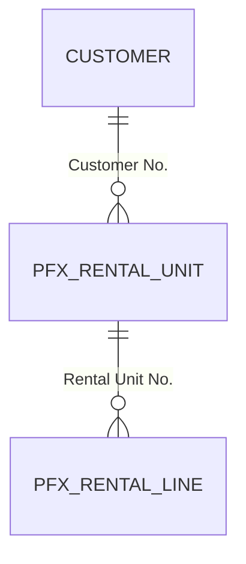

> **Template** for `docs/DataModel.md` — OCPF BC Agentic Development Framework, Build-a-Feature journey (Ops § Build-a-Feature → *The record*). On a Full or Lite project the same file is written beside the project's own as `docs/2-design/DataModel.md`. **Written before the human confirms each object, not at the close:** the moment a table, table extension, or enum is proposed, its section is written here (marked *proposed*), so the human verifies the design on disk — fields, types, lengths, keys, relations — before anything is built; the section is updated when they confirm, and again if a compile forces a change. Pages, APIs, and permission sets appear in §4 and §5 as the objects that expose or protect the data. Keep every heading; replace every `<placeholder>`; a section that doesn't apply keeps its heading with *N/A — reason* beneath it; delete this note. A later session appends sections and redraws the diagram.

# Data Model — <Extension Name>

**Updated:** <date> · **Journey:** Build-a-Feature · **Prefix:** <PFX> · **Namespace:** <namespace or none>

## 1. Diagram
Every table this extension owns, every standard table it extends or relates to, and the relations between them, drawn from the code. Rendered to an image only when `ocpfFramework/framework.json` already records `tooling.mermaid` as available; otherwise left as source with the line *not rendered here; GitHub and VS Code render Mermaid* — never install or download anything at a quick mod's close.

## 2. Tables
One section per table this extension owns, in build order. The field table is the design the human confirmed; a type or length that differs from the inference table (`field-types.md`) is a decision and is also listed in `docs/FeatureRegister.md` §4.

### 2.<n> Table <ID> "<PFX Name>" — <proposed / confirmed / compiled>
**Purpose:** <one sentence: what one record is>
**Primary key:** <field(s)> · **Numbering:** <manual / number series from <setup table field> / none>
**File:** `src/<…>.Table.al`

| # | Field | Type | Meaning | Relation / validation |
|---|---|---|---|---|
| 1 | No. | Code[20] | <what identifies the record> | <number series, NotBlank> |
| 2 | Description | Text[100] | <…> | — |
| 10 | Customer No. | Code[20] | <…> | TableRelation Customer; <blank allowed?> |
| 20 | Status | Enum <PFX Status> | <…> | <default value> |

**Keys:** <secondary keys and why> · **FlowFields:** <any, with the CalcFormula in words> · **Deletion:** <what happens to child records>

## 3. Table extensions and enums
### 3.<n> Table Extension <ID> "<PFX Name>" extends "<Standard table>" — <proposed / confirmed / compiled>
**File:** `src/<…>.TableExt.al`
| # | Field | Type | Meaning | Relation / validation |
|---|---|---|---|---|
| 50100 | <PFX Field> | <type> | <…> | <…> |

### 3.<n> Enum <ID> "<PFX Name>" — <proposed / confirmed / compiled> · **Extensible:** <yes / no>
**File:** `src/<…>.Enum.al`
| Ordinal | Value | Caption | Meaning |
|---|---|---|---|
| 0 | <Value> | <caption> | <…> |

## 4. Where the data is shown and reached
| Data | Page / API / report | Object | Read or write |
|---|---|---|---|
| <PFX Rental Unit> | List page | <ID> "<PFX Rental Units>" | read; opens the card |
| <PFX Rental Unit> | Card page | <ID> "<PFX Rental Unit Card>" | read-write |
| <PFX Rental Unit> | API page | <ID> "<PFX Rental Units API>" — `/api/<publisher>/<group>/<version>/companies({id})/<entitySet>` | <read / read-write> |

## 5. Who may read or change it
*N/A — no permission set yet; every user needs SUPER* **or** one row per permission set and the tables it grants (Standards §5.3).
| Permission set | Tables (R I M D) | Pages / reports executed |
|---|---|---|
| <PFX APPCODE, VIEW> | <PFX Rental Unit> R | <list, card> |
| <PFX APPCODE, EDIT> | <PFX Rental Unit> RIMD | <list, card, report> |

## 6. Standard objects this extension depends on
Every standard table, page, codeunit, or event the objects reference, symbol-verified (Standards Appendix B). *N/A — none* when the extension stands alone.
| Standard object | Used by | For |
|---|---|---|
| Table 18 Customer | <PFX Rental Unit>.Customer No. | relation and lookup |
