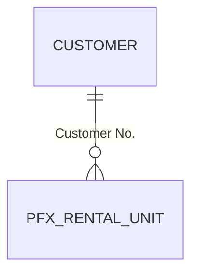

> **Template** for `docs/1-define/FeatureRegister.md` — OCPF BC Agentic Development Framework, Build-a-Feature journey, written at the close (Ops § Build-a-Feature → *The record*) from what the session already knows — one to two minutes, no research. It merges what Full keeps in `ProjectParameters.md` and `ObjectRegister.md`. Keep every heading; replace every `<placeholder>`; a section that doesn't apply keeps its heading with *N/A — reason* beneath it; delete this note. A later session appends to the object table and redraws the diagram.

# Feature Register — <Extension Name>

**Updated:** <date> · **Journey:** Build-a-Feature · **Sessions:** <n>

## 1. Parameters
| Parameter | Value |
|---|---|
| Extension name / publisher | <name> / <publisher> |
| App id | <GUID> |
| Deployment Target | <SaaS PTE / OnPrem PTE> |
| AL object prefix / namespace | <prefix> / <namespace or none> |
| Object ID range(s) | <start–end (n IDs)> |
| Permission Set App Code | <code or not yet> |
| BC version / runtime | <application> / <runtime> |
| Main model / effort | <model> / <effort> |
| Version now / packages | <app.json version> / <versions in outputAppPackage/, or none> |

## 2. Objects
One row per object this journey built, in build order; the `Row` is the feature table's id in `ProjectProgress.md`.
| Row | Type | ID | Name | File | Base object (extensions) | Relates to | Session |
|---|---|---|---|---|---|---|---|
| F01 | Table | 50100 | <PFX Rental Unit> | src/<…>.Table.al | — | Customer (Customer No.) | <date> |

## 3. Schema
Every table this extension owns and every standard table it relates to or extends, drawn from the code. Rendered only when `ocpfFramework/framework.json` already records `tooling.mermaid` as available; otherwise left as source with the line *not rendered here; GitHub and VS Code render Mermaid* — never install or download anything at a quick mod's close.

## 4. Decisions worth keeping
Three lines at most per session: a field type the human changed, a relation chosen, an enum's `Extensible` answer, a review finding declined.
- <date> — <decision>
